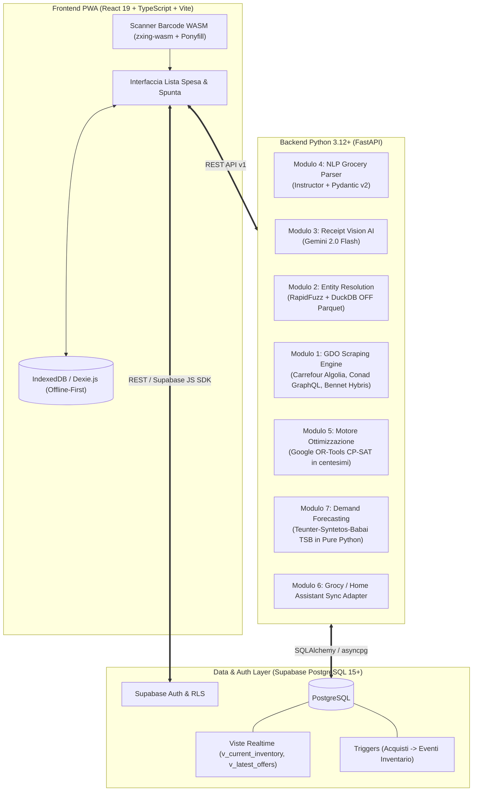

# Smart Grocery Agent — Architettura e Integrazioni Definitive

**Data:** 5 novembre 2026  
**Stato:** Approvato per l'implementazione  
**Sintesi:** Tutti gli 8 moduli del sistema sono stati validati tramite ricerca analitica approfondita.

---

## 1. Mappa dei Componenti & Stack Tecnologico



---

## 2. Dettaglio dei Moduli

### Modulo 1: Ingestion Prezzi e Cataloghi GDO
- **Carrefour Italia:** Query diretta HTTP agli indici **Algolia** (`<APP_ID>-dsn.algolia.net`) con le Search-Only API Keys pubbliche del frontend web. Zero WAF, risposte JSON pulite con EAN, prezzi e sconti.
- **Bennet:** Endpoint REST nativi di **SAP Hybris OCC v2** (`/occ/v2/bennet/products/search?fields=FULL`).
- **Conad / HeyConad:** Endpoint **GraphQL** con paginazione a cursori (`first: 50, after: "..."`) e filtro per CAP/storeId.
- **Lidl:** Client reverse-engineered da Lidl Plus (`Andre0512/lidl-plus`) per scontrini ed offerte promozionali.
- **Esselunga:** Bypassing Akamai Bot Manager (`_abck`) tramite **`curl_cffi`** (impersonazione TLS Chrome 124) e sessioni con **Patchright** stealth.
- **Volantini Promo:** Reverse engineering degli hotspot JSON di ShopFully (`api.shopfully.cloud` - DoveConviene / PromoQui).

### Modulo 2: Entity Resolution & Catalogo Open Food Facts
- **Dump Open Food Facts Italia:** Ingestion streaming ad alta velocità e zero-RAM tramite **DuckDB** direttamente dal dataset Parquet su Hugging Face, popolando `products` e `product_variants`.
- **Riconciliazione Ibrida:**
  - *Stage 1 (Retrieval):* Ricerca EAN esatto + ricerca per trigrammi (`pg_trgm`) e similarità vettoriale HNSW (`pgvector`).
  - *Stage 2 (Reranking in memoria):* Scoring composito con **RapidFuzz** (`token_sort_ratio` e `token_set_ratio`).
- **Parsing Quantità & Multipack:** Regex specializzata sul retail italiano (`4x330ml`, `0,5 kg`, `2 etti`) con conversione alle unità base standard (`g`, `ml`, `unit`).

### Modulo 3: OCR Scontrini & Document AI
- **Engine:** **Gemini 2.0 Flash / GPT-4o-mini** multimodale via JSON Schema strutturato.
- **Vantaggi rispetto a Tesseract/PaddleOCR:** Accuratezza 95%+ su carta termica piegata, decodifica nativa delle abbreviazioni di cassa RT italiane (`"LT PARZ SCR"`, `"PASS POMOD MUTTI"`), costo trascurabile (< €0.0005 per scontrino).
- **Sanity Check Contabile:** Validatore matematico automatico:
  $$\sum (\text{Prezzi Articoli}) - \sum (\text{Sconti}) == \text{Totale} \quad (\text{tolleranza } \pm 0.02\text{ \euro{}})$$

### Modulo 4: NLP Lista della Spesa Colloquiale
- **Engine:** **Instructor + Pydantic v2** con modello LLM leggero.
- **Estrazioni Intelligenti:**
  - `clean_search_query`: isola la parola chiave pura per la ricerca a catalogo (es. *"fusilli"* da *"2 pacchi di fusilli de cecco da 500g"*).
  - Alternative di marca: `"Rio Mare oppure Nostromo se costa meno"`.
  - Normalizzazione moltiplicatori: *"1 cassa d'acqua da 6 bottiglie da 1,5L"* $\to 9.000\text{ ml}$.
  - Vincoli di offerta e budget: *"solo se in offerta"*, *"al massimo 10€/kg"*.

### Modulo 5: Motore di Ottimizzazione della Spesa (Split-Basket)
- **Engine:** **Google OR-Tools CP-SAT**.
- **Formulazione Matematica:**
  - *Fixed-Charge Facility Location (FC-FLP):* variabile binaria $y_j \in \{0, 1\}$ per ciascun supermercato con costo fisso di visita $F_j$.
  - *Multi-Choice Reverse Covering:* variabili intere per il conteggio di confezioni, coprendo la quantità richiesta minimizzando costo totale e spreco (overfill).
  - *Single-SKU Constraint:* divieto di spezzare il medesimo articolo su brand concorrenti nello stesso carrello.
- **Aritmetica Intera:** Prezzi in centesimi di euro (€ $1.49 \to 149$) per totale stabilità e precisione deterministica.
- **Performance:** Risoluzione all'ottimo provato in **$20 - 60\text{ ms}$** per istanze realistiche (25–30 prodotti e 5 supermercati).

### Modulo 6: Gestione Dispensa & Integrazione Grocy / Home Assistant
- **Architettura Ibrida:**
  - *Core Nativo Supabase:* Tabelle snelle per multi-store, tracciamento storico e ottimizzazione spesa indipendente.
  - *Grocy Sync Connector:* Sincronizzazione bidirezionale opzionale per utenti con server Home Assistant locale (scarico automatico prodotti esauriti $\to$ proposta carrello spesa ottimizzato; spesa effettuata $\to$ carico automatico lotti e scadenze su Grocy).

### Modulo 7: Demand Forecasting per Consumi Domestici
- **Algoritmo:** **TSB (Teunter-Syntetos-Babai)** in Python puro a zero dipendenze pesanti.
- **Trattamento della Domanda Intermittente:** Separa la probabilità giornaliera di consumo ($p_t$) dalla dimensione media dell'evento ($z_t$). Se un prodotto non viene più consumato, la probabilità decade esponenzialmente senza falsi allarmi di riordino.
- **Safety Stock:** Calcolo della scorta di sicurezza basato sulla varianza composita del processo di Bernoulli.
- **Output:** Stima della `suggested_reorder_date` e del `confidence_score`.

### Modulo 8: Frontend PWA & Scanner Barcode Mobile
- **Ponyfill Barcode Scanner:** `@sec-ant/barcode-detector` con runtime WebAssembly **`zxing-wasm`**:
  - Su Chrome Android: accelerazione nativa GPU (BarcodeDetector API).
  - Su Safari iOS: esecuzione WASM SIMD a 60 FPS senza surriscaldamento.
- **Hardware Mobile:** Torcia (supportata nativamente su Android e iOS 17.5.1+), Screen Wake Lock per impedire il blocco schermo tra le corsie, Web Audio API per beep sintetico di conferma e vibrazione aptica.
- **Offline-First:** `vite-plugin-pwa` con pre-caching del binario `.wasm` e memorizzazione offline della lista su IndexedDB con **Dexie.js**.

---

## 3. Matrice delle Dipendenze di Sviluppo

```text
Fase 1: Core Matematico & Modelli
  ├── 1.1 Schemi Pydantic v2 (Input/Output di tutti i domini)
  └── 1.2 Motore OR-Tools CP-SAT (Ottimizzazione deterministica)

Fase 2: Backend FastAPI & Connettori
  ├── 2.1 Connettore Supabase (asyncpg / supabase-py)
  ├── 2.2 Parser NLP & Scontrini (Instructor + Gemini Flash)
  ├── 2.3 Scraper GDO a basso attrito (Algolia Carrefour + Bennet OCC)
  └── 2.4 Modulo Forecasting TSB (Pure Python)

Fase 3: Frontend PWA React
  ├── 3.1 Setup Vite + Tailwind + PWA
  ├── 3.2 Componente Barcode Scanner (zxing-wasm)
  └── 3.3 Gestione Lista Spesa & Visualizzazione Split-Basket
```
