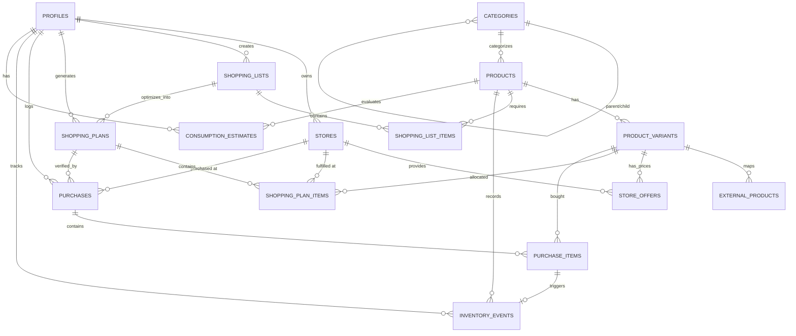

# Smart Grocery Agent — Database Design & Schema Reference

**Version:** 1.0  
**Target:** Supabase PostgreSQL 15+  
**Status:** Approved for Implementation  

---

## 1. Overview & Architectural Principles

The database layer of **Smart Grocery Agent** is designed to model grocery planning, cross-store price comparison, mathematical optimization, and event-sourced household consumption.

### Core Principles

1. **Separation of Canonical Products from Purchasable Variants**:
   - `products` represent generic culinary/household items (e.g. *Spaghetti*, *Latte UHT*, *Uova*).
   - `product_variants` represent concrete manufacturer configurations (e.g. *Barilla Spaghetti N.5 500g*, *De Cecco Spaghetti N.12 500g*).
   - The user/agent adds canonical products to the shopping list; the optimizer evaluates all matching variants and their store-specific offers.

2. **Unified Base Units for Deterministic Comparison**:
   - All weights are normalized to **grams (`g`)**.
   - All liquids/volumes are normalized to **milliliters (`ml`)**.
   - All piece-based items are normalized to **units (`unit`)**.
   - Every offer computes `price_per_base_unit` (e.g. €/g, €/ml), allowing direct mathematical comparison regardless of package sizing (e.g., comparing 500g at €1.10 vs 1kg at €1.99).

3. **Event-Sourced Household Inventory**:
   - We do not store an easily corruptible scalar `stock` column that is directly updated.
   - All stock changes are recorded as discrete rows in `inventory_events` (`purchase`, `consumption`, `waste`, `adjustment`, `expiration`).
   - The current stock is derived via the `v_current_inventory` real-time view or aggregated over time, preserving a complete audit trail for consumption forecasting.

4. **Preservation of Price Provenance & History**:
   - Offers are never destructively overwritten. Historical price observations remain stored in `store_offers`, tracking promotional validity intervals, source, and confidence.

5. **Row Level Security (RLS)**:
   - All sensitive user-specific data (stores, lists, plans, purchases, inventory) is strictly scoped to `auth.uid() = user_id`.
   - The product catalog supports a hybrid model: global system entries (`user_id IS NULL`) are readable by all authenticated users, while personal custom entries are private to the creator.

---

## 2. Entity-Relationship (ER) Diagram



---

## 3. Data Dictionary

### 3.1 `profiles`
User preferences, home coordinates, and trip cost parameters.

| Column | Type | Constraints | Description |
|---|---|---|---|
| `id` | `UUID` | PK, FK `auth.users(id)` | References Supabase user |
| `email` | `TEXT` | | User email mirror |
| `full_name` | `TEXT` | | Display name |
| `default_currency`| `TEXT` | DEFAULT `'EUR'` | Currency symbol/ISO |
| `max_stores_per_trip` | `INT` | DEFAULT `2`, `>= 1` | Max stores in single optimization |
| `default_visit_cost` | `NUMERIC(6,2)` | DEFAULT `2.00` | Inconvenience/fixed penalty per store visit |
| `travel_cost_per_km` | `NUMERIC(5,2)` | DEFAULT `0.35` | Fuel/vehicle cost per kilometer |
| `home_address` | `TEXT` | | Human-readable address |
| `home_latitude` | `NUMERIC(9,6)` | | Geo latitude for distance matrix |
| `home_longitude`| `NUMERIC(9,6)` | | Geo longitude for distance matrix |
| `preferences` | `JSONB` | DEFAULT `'{}'` | Dietary restrictions, retailer biases |
| `created_at` | `TIMESTAMPTZ` | DEFAULT `NOW()` | Record creation timestamp |
| `updated_at` | `TIMESTAMPTZ` | DEFAULT `NOW()` | Auto-updated timestamp |

---

### 3.2 `categories`
Hierarchical taxonomy for organizing products.

| Column | Type | Constraints | Description |
|---|---|---|---|
| `id` | `UUID` | PK, DEFAULT `gen_random_uuid()` | Unique category identifier |
| `parent_id` | `UUID` | FK `categories(id)` | Parent category for nesting |
| `name` | `TEXT` | NOT NULL | e.g. "Pasta, Riso e Farine" |
| `slug` | `TEXT` | UNIQUE, NOT NULL | URL-safe identifier (e.g. `pasta-riso`) |
| `icon` | `TEXT` | | Lucide icon identifier |
| `display_order` | `INT` | DEFAULT `0` | UI ordering |

---

### 3.3 `products`
Canonical products (abstract items independent of brand and packaging).

| Column | Type | Constraints | Description |
|---|---|---|---|
| `id` | `UUID` | PK, DEFAULT `gen_random_uuid()` | Unique product identifier |
| `user_id` | `UUID` | FK `auth.users(id)` (NULLable) | NULL for global items, User ID for custom items |
| `category_id` | `UUID` | FK `categories(id)` | Product category |
| `name` | `TEXT` | NOT NULL | e.g. "Spaghetti", "Latte UHT" |
| `description` | `TEXT` | | Culinary or storage details |
| `base_unit` | `TEXT` | CHECK in `('g', 'ml', 'unit')` | Canonical base unit for math |
| `default_shelf_life_days` | `INT` | CHECK `> 0` | Typical expiration span in days |
| `min_stock_level` | `NUMERIC(10,2)`| DEFAULT `0` | Safety stock threshold |
| `reorder_threshold` | `NUMERIC(10,2)`| DEFAULT `0` | Reorder trigger quantity in `base_unit` |
| `is_essential` | `BOOLEAN` | DEFAULT `false` | High priority in household restocking |

---

### 3.4 `product_variants`
Specific, purchasable physical configurations.

| Column | Type | Constraints | Description |
|---|---|---|---|
| `id` | `UUID` | PK, DEFAULT `gen_random_uuid()` | Unique variant identifier |
| `product_id` | `UUID` | NOT NULL, FK `products(id)` | Parent canonical product |
| `brand` | `TEXT` | | e.g. "Barilla", "De Cecco", "Esselunga Smart" |
| `name` | `TEXT` | NOT NULL | e.g. "Spaghetti N. 5 500g" |
| `package_size` | `NUMERIC(10,2)`| CHECK `> 0` | Label quantity (e.g. `500`, `1`, `6`) |
| `package_unit` | `TEXT` | NOT NULL | Unit string (e.g. `'g'`, `'kg'`, `'l'`, `'pz'`) |
| `base_quantity`| `NUMERIC(10,2)`| CHECK `> 0` | Amount in `product.base_unit` (e.g. 500 for 500g, 1000 for 1kg) |
| `barcode` | `TEXT` | | EAN-13, UPC code |
| `is_favorite` | `BOOLEAN` | DEFAULT `false` | User favorite preference flag |

---

### 3.5 `stores`
Physical supermarket locations configured by the user.

| Column | Type | Constraints | Description |
|---|---|---|---|
| `id` | `UUID` | PK, DEFAULT `gen_random_uuid()` | Unique store identifier |
| `user_id` | `UUID` | NOT NULL, FK `auth.users(id)` | Owner user ID |
| `name` | `TEXT` | NOT NULL | Display name (e.g. "Esselunga - Via Washington") |
| `chain` | `TEXT` | NOT NULL | Chain identifier (e.g. "Esselunga", "Lidl") |
| `address` | `TEXT` | | Street address |
| `latitude` | `NUMERIC(9,6)` | | Store latitude |
| `longitude` | `NUMERIC(9,6)` | | Store longitude |
| `distance_km` | `NUMERIC(5,2)` | | Calculated/estimated distance from home |
| `visit_cost_override` | `NUMERIC(6,2)`| | Custom trip penalty override |
| `is_active` | `BOOLEAN` | DEFAULT `true` | Enabled in optimization |
| `opening_hours` | `JSONB` | DEFAULT `'{}'` | Structured open/close schedule |

---

### 3.6 `store_offers`
Price observations and promotional deals.

| Column | Type | Constraints | Description |
|---|---|---|---|
| `id` | `UUID` | PK, DEFAULT `gen_random_uuid()` | Unique offer record ID |
| `store_id` | `UUID` | NOT NULL, FK `stores(id)` | Observed store location |
| `variant_id` | `UUID` | NOT NULL, FK `product_variants(id)`| Specific variant on sale |
| `price` | `NUMERIC(10,2)`| NOT NULL, CHECK `>= 0` | Actual package selling price (€) |
| `standard_price` | `NUMERIC(10,2)`| | Non-discounted price if on promo |
| `price_per_base_unit` | `NUMERIC(10,4)`| NOT NULL | Price normalized to base unit (e.g. €/g) |
| `is_promotion` | `BOOLEAN` | DEFAULT `false` | Promotional flag |
| `promo_description` | `TEXT` | | Promo terms (e.g. "Prezzi Corti -30%") |
| `valid_from` | `TIMESTAMPTZ` | | Start of promotion validity |
| `valid_to` | `TIMESTAMPTZ` | | Expiration of promotion |
| `source` | `TEXT` | NOT NULL, DEFAULT `'manual'` | `'manual'`, `'flyer'`, `'receipt'`, `'api'` |
| `confidence` | `NUMERIC(3,2)` | DEFAULT `1.00` | Data trust rating (0.00 to 1.00) |
| `observed_at` | `TIMESTAMPTZ` | DEFAULT `NOW()` | Timestamp when price was recorded |

---

### 3.7 `shopping_lists` & `shopping_list_items`
Shopping requirements collected from the user or generated by AI agent.

- `shopping_lists` includes `status` (`'draft'`, `'active'`, `'completed'`, `'archived'`), `budget_limit`, and `max_stores`.
- `shopping_list_items` includes:
  - `quantity`: requested amount.
  - `unit`: user's requested unit.
  - `base_quantity`: automatically converted into `products.base_unit`.
  - `is_mandatory`: boolean constraint for the solver.
  - `preferred_brands`: array of preferred brand strings.
  - `is_checked`: tick mark state in the UI.

---

### 3.8 `shopping_plans` & `shopping_plan_items`
Deterministic outputs generated by the OR-Tools optimization engine.

- `shopping_plans`:
  - `status`: `'optimal'`, `'feasible'`, `'infeasible'`, `'unknown'`.
  - `total_product_cost`: sum of all allocated item prices.
  - `total_travel_cost`: sum of store visit penalties.
  - `total_cost`: product cost + travel cost.
  - `estimated_savings`: difference compared to purchasing everything at the single most expensive or default store.
  - `selected_store_ids`: array of UUIDs of chosen supermarkets.
  - `solver_details`: JSONB telemetry (solve time, search branches, constraints count).

- `shopping_plan_items`:
  - Allocation breakdown: which store, which variant, how many packages, unit price, total price, and reference to `store_offers`.

---

### 3.9 `purchases` & `purchase_items`
Actual historical transactions recorded by the user or extracted via receipt OCR.

- When a `purchase_item` is inserted with a linked `variant_id`, the database trigger `trg_after_purchase_item_insert` automatically writes a corresponding `'purchase'` record into `inventory_events`.

---

### 3.10 `inventory_events`
Ledger of all household stock changes.

| Column | Type | Description |
|---|---|---|
| `id` | `UUID` | PK |
| `user_id` | `UUID` | FK `auth.users(id)` |
| `product_id` | `UUID` | FK `products(id)` |
| `variant_id` | `UUID` | FK `product_variants(id)` (optional) |
| `purchase_item_id` | `UUID` | FK `purchase_items(id)` (if triggered by purchase) |
| `event_type` | `TEXT` | `'purchase'`, `'consumption'`, `'waste'`, `'adjustment'`, `'expiration'` |
| `quantity_delta` | `NUMERIC(10,2)`| Positive for stock additions, negative for consumption |
| `base_unit` | `TEXT` | Canonical unit (`g`, `ml`, `unit`) |
| `event_date` | `TIMESTAMPTZ`| When event occurred |

---

### 3.11 `consumption_estimates`
Aggregated metrics and consumption predictions calculated by the backend Python service.

- `daily_avg_consumption`: Estimated consumption per day in `base_unit`.
- `predicted_depletion_date`: Projected date when stock reaches 0.
- `suggested_reorder_date`: Projected date when stock drops below `reorder_threshold`.
- `confidence_score`: Statistical model confidence.

---

## 4. Key Functions & Views

### 4.1 Unit Normalization: `to_base_quantity(amount, unit)`
```sql
SELECT to_base_quantity(500, 'g');   -- returns 500
SELECT to_base_quantity(1.5, 'kg');  -- returns 1500
SELECT to_base_quantity(1, 'l');     -- returns 1000
SELECT to_base_quantity(6, 'pz');    -- returns 6
```

### 4.2 Real-time Inventory View: `v_current_inventory`
Provides an immediate calculation of current stock and reorder warnings:
```sql
SELECT product_name, current_stock, base_unit, is_below_reorder_threshold
FROM v_current_inventory
WHERE user_id = auth.uid() AND is_below_reorder_threshold = true;
```

### 4.3 Latest Active Offers View: `v_latest_offers`
Deduplicates historical prices to return the single latest valid offer for every store and variant combination.

---

## 5. Security & Row Level Security (RLS)

| Table | RLS Policy Scope | Permissions |
|---|---|---|
| `profiles` | `auth.uid() = id` | ALL |
| `categories` | Authenticated users | SELECT |
| `products` | `user_id IS NULL OR user_id = auth.uid()` | SELECT (global + custom), ALL (custom only) |
| `product_variants` | Parent product is accessible | SELECT (if product visible), ALL (if product owned) |
| `stores` | `user_id = auth.uid()` | ALL |
| `external_products` | Authenticated users | ALL |
| `store_offers` | User owns associated `store_id` | ALL |
| `shopping_lists` | `user_id = auth.uid()` | ALL |
| `shopping_list_items` | User owns parent `list_id` | ALL |
| `shopping_plans` | `user_id = auth.uid()` | ALL |
| `shopping_plan_items` | User owns parent `plan_id` | ALL |
| `purchases` | `user_id = auth.uid()` | ALL |
| `purchase_items` | User owns parent `purchase_id` | ALL |
| `inventory_events` | `user_id = auth.uid()` | ALL |
| `consumption_estimates`| `user_id = auth.uid()` | ALL |

---

## 6. How to Apply Migrations

To apply this schema to a Supabase project:

```bash
# Using Supabase CLI
supabase db push

# Or execute directly in Supabase SQL Editor:
# 1. supabase/migrations/20261105000000_initial_schema.sql
# 2. supabase/seed.sql
```
